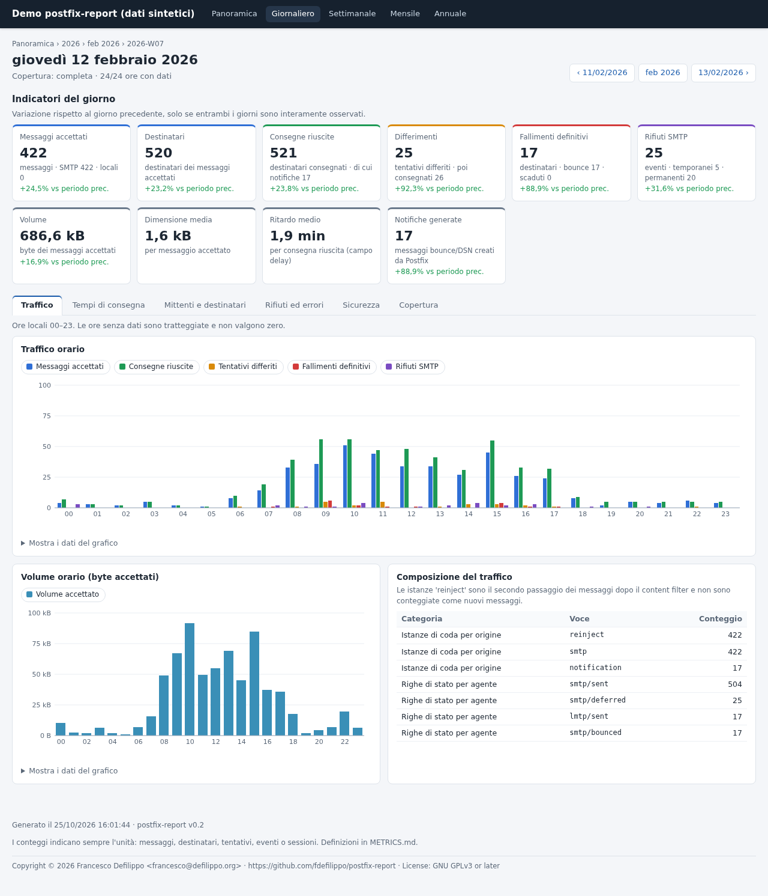
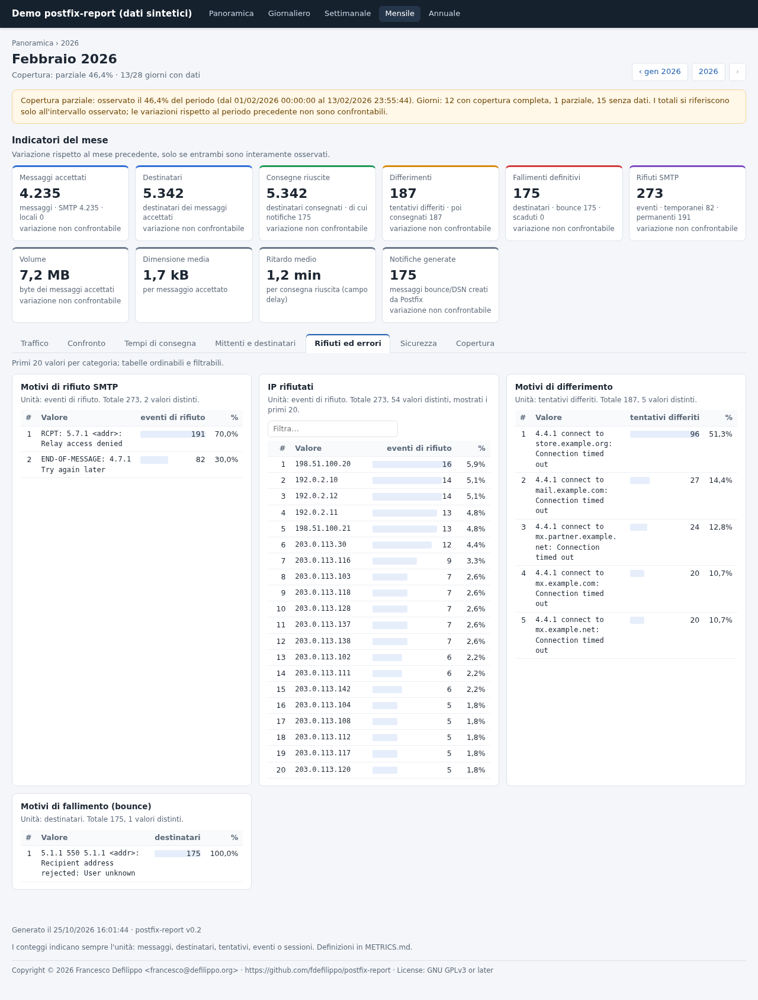
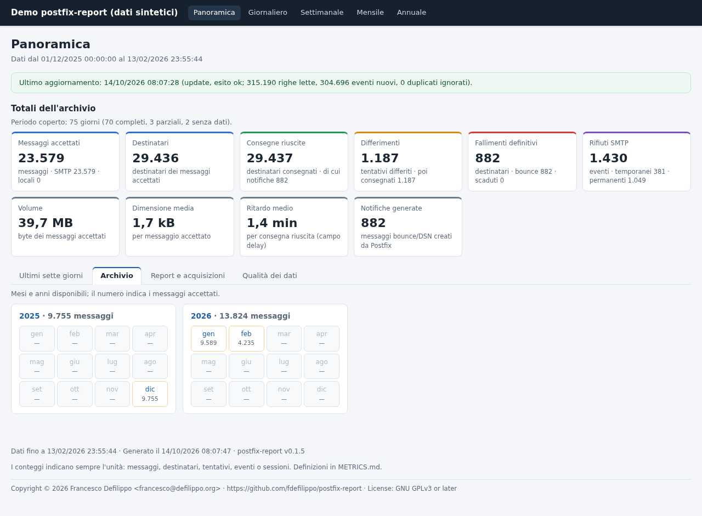

# postfix-report

**English** · [Italiano](README.md)

Postfix log analysis with a SQLite history and **static HTML reports**
(daily, ISO 8601 weekly, monthly, yearly), updated incrementally by a systemd
timer. No external services, Internet access or application servers are
needed: the reports can be served by any static web server or opened directly
via `file://`.

* **Verifiable statistics**: messages, recipients, attempts, deliveries,
  deferrals, permanent failures, SMTP rejections, bounces, volumes, delays
  with exact percentiles, TLS and SASL. The definitions are in
  [METRICS.md](METRICS.md), the comparison with independent counts on the real
  log in [VALIDATION.md](VALIDATION.md).
* **Correct correlation**: reused Queue IDs, messages spanning several days
  and files, multiple recipients counted once, deferrals followed by success,
  content-filter reinjection recognized (a filtered message does not become
  two messages).
* **Missing data ≠ zero**: every hour, day and period reports its own
  coverage. Hours without logs are shown as missing, not as zero traffic.
* **Idempotent import**: sources are recognized by their content. Rotation,
  `.gz` files, re-reads, overlaps and interruptions never duplicate data.
* **Selective regeneration**: only the pages whose data changed are rewritten,
  with atomic file replacement.
* **Tabbed pages**: the period's indicators stay at the top; the rest is split
  into tabs (traffic, comparison, delivery times, senders and recipients,
  rejections and errors, security, coverage). The selected tab stays active
  when moving to another report and is reflected in the URL
  (`#rifiuti-ed-errori`). Without JavaScript and when printing, all sections
  are shown one after the other.

The report pages, the messages of the program and the other documents
(METRICS.md, VALIDATION.md, LOG_ANALYSIS.md, LIMITATIONS.md, the man page) are
in Italian.



<details>
<summary>More screenshots (synthetic data)</summary>





</details>

Observed log formats: [LOG_ANALYSIS.md](LOG_ANALYSIS.md) · Known limitations:
[LIMITATIONS.md](LIMITATIONS.md) · Demo reports (synthetic data):
[`demo/index.html`](demo/index.html).

## Architecture

```text
maillog(.gz) ─► streaming parser ─► normalized events ─► Queue ID correlation
                (internal/logparse)  (internal/ingest)    (internal/correlate)
                                                                   │
  HTML reports ◄── generator ◄── queries ◄── aggregates ◄── SQLite
  (output/)      (internal/report) (internal/query) (internal/aggregate) (internal/store)
```

| Package | Responsibility |
|---|---|
| `internal/logparse` | Syntactic parsing of syslog/Postfix lines, year and DST |
| `internal/ingest` | Sources (fingerprint), checkpoints, gzip, deduplication, coverage |
| `internal/correlate` | Queue instances, recipients, attempts, reinjections, rejections |
| `internal/aggregate` | Hourly metrics and daily rankings, recomputable |
| `internal/query` | Totals, series, coverage, exact percentiles |
| `internal/report` | HTML pages, local CSS/JS assets, atomic writes |
| `internal/verify` | DB integrity, invariants, aggregates, report links |
| `internal/app` | Orchestration, locking, page invalidation |

The database is the source of the reports: logs can be rotated away without
losing the history. The schema is versioned (`internal/store/migrations`).

## Building

Go 1.25 or later is required. The binary is static (no cgo, pure-Go SQLite
driver): it builds anywhere and runs on any Linux of the same architecture,
Enterprise Linux 8/9/10 included.

```bash
make build        # bin/postfix-report
make check        # gofmt, go vet, tests
make bench        # parser and pipeline benchmarks
```

## Installing the RPM (Enterprise Linux 8/9/10)

Prebuilt RPMs for EL8, EL9 and EL10 are attached to the
[GitHub releases](https://github.com/fdefilippo/postfix-report/releases),
together with SRPMs, sources and `SHA256SUMS`. To build them yourself, on an
EL machine with `golang` (≥ 1.25) and `rpm-build` installed:

```bash
sudo dnf install golang rpm-build systemd-rpm-macros git make
make rpm          # dist/rpmbuild/RPMS/x86_64/postfix-report-<version>-1.el9.x86_64.rpm
sudo dnf install dist/rpmbuild/RPMS/x86_64/postfix-report-*.rpm
```

`make rpm` first creates `dist/postfix-report-<version>.tar.gz` (sources plus
`vendor/`, so `rpmbuild` needs no network) and then runs `rpmbuild -ba`.
`make srpm` only produces the SRPM, useful with `mock`. The version is the one
in the spec file (`packaging/rpm/postfix-report.spec`). The binary is static:
an RPM built on EL9 also installs on EL10.

To publish a release, update `Version` and `%changelog` in the spec and the
version in `docs/postfix-report.1`, then create and push the tag
(`git tag -a v0.2 && git push origin v0.2`). The workflow
`.github/workflows/release.yml` checks the versions (`make release-check`),
builds the RPMs and the `.deb` packages and creates the release. It runs only
on tags.

The package installs:

| Path | Content |
|---|---|
| `/usr/bin/postfix-report` | binary |
| `/etc/postfix-report/config.yaml` | configuration (`root:postfix-report 0640`, not overwritten on upgrades) |
| `/usr/lib/systemd/system/postfix-report.{service,timer}` | systemd units (timer not enabled) |
| `/var/lib/postfix-report/` | database (`0750`) |
| `/var/www/html/postfix-report/` | HTML reports (`0755`) |
| `/usr/share/doc/postfix-report/examples/` | sample configurations for Apache, Nginx and cron |

It also creates the `postfix-report` system user. After installation, three
steps remain: log read permissions (below), checking the configuration and
enabling the timer:

```bash
sudo postfix-report -config /etc/postfix-report/config.yaml check-config
sudo runuser -u postfix-report -- postfix-report -config /etc/postfix-report/config.yaml update
sudo systemctl enable --now postfix-report.timer
```

## Installing the .deb (Debian, Ubuntu)

`.deb` packages for amd64 and arm64 are attached to the same releases. The
binary is static (with the time zone database embedded), so the same package
works on Debian 12/13 and Ubuntu 22.04/24.04 and later:

```bash
sudo apt install ./postfix-report_<version>-1_amd64.deb
```

To build it yourself you only need Go ≥ 1.25 and `dpkg-deb`: `make deb` (or
`make deb DEB_ARCH=arm64`) produces `dist/postfix-report_<version>-1_<arch>.deb`.
Debian's own Go is too old for this module: the package is assembled around
the binary built with the official Go toolchain, with no system dependencies.

Compared with the RPM, only these details differ:

* **Logs**: in `/etc/postfix-report/config.yaml` the default paths are
  `/var/log/mail.log` and `/var/log/mail.log.*`. These files are
  `root:adm 0640` and the service reads them through `SupplementaryGroups=adm`:
  no ACLs are needed. For other paths, edit `input.paths`.
* **Report directory**: `/var/www/html/postfix-report` is created by
  `postinst` (Debian policy does not allow shipping it in the package).
* **Timer**: not enabled on installation. If the administrator enables it,
  the choice is kept across upgrades; `apt purge` resets it.
* **Removal**: `apt purge` removes the configuration but keeps the database,
  the reports and the system user.

## Manual installation (Enterprise Linux example)

```bash
# 1. Binary and documentation
sudo make install                       # /usr/local/bin/postfix-report

# 2. Service user without login (the program must not run as root)
sudo useradd --system --home-dir /var/lib/postfix-report --shell /sbin/nologin postfix-report

# 3. Directories: private database, HTML readable by the web server
sudo install -d -m 0750 -o postfix-report -g postfix-report /var/lib/postfix-report
sudo install -d -m 0755 -o postfix-report -g postfix-report /var/www/html/postfix-report
sudo install -d -m 0755 /etc/postfix-report
sudo install -m 0640 -o root -g postfix-report config.example.yaml /etc/postfix-report/config.yaml

# 4. SELinux (EL): restore the contexts of the published directory
sudo restorecon -Rv /var/www/html/postfix-report
```

### Log read permissions

The service reads the logs as the `postfix-report` user.

* **Debian/Ubuntu**: `/var/log/mail.log*` are `root:adm 0640`. The systemd
  unit already adds the `adm` group (`SupplementaryGroups=adm`). In the
  configuration use `paths: [/var/log/mail.log, /var/log/mail.log.*]` (the
  default in the `.deb` package).
* **Enterprise Linux**: `/var/log/maillog` is `root:root 0600`. Two options:
  1. **rsyslog** (recommended): have the file created with a dedicated group,
     in `/etc/rsyslog.d/maillog.conf`:
     ```
     mail.* action(type="omfile" file="/var/log/maillog" fileGroup="postfix-report" fileCreateMode="0640")
     ```
     Remove the default `mail.*` line from `/etc/rsyslog.conf`, then run
     `systemctl restart rsyslog`. Rotated files keep the group.
  2. **ACL**: `setfacl -m u:postfix-report:r /var/log/maillog`. The ACL must be
     reapplied after every rotation with a `postrotate` in
     `/etc/logrotate.d/rsyslog`. If rotation compresses the files, check that
     the `.gz` files remain readable.

  Check: `runuser -u postfix-report -- head -1 /var/log/maillog`.

### Write permissions

* The database (`/var/lib/postfix-report/report.db`) is created with mode
  `0640` in a `0750` directory: it contains addresses and IPs and **must not
  live under the web directory** (the configuration rejects that).
* The HTML directory must be writable by the `postfix-report` user and
  readable by the web server. Pages are created with mode `0644`.

## Configuration

See [`config.example.yaml`](config.example.yaml) (comments in Italian). The
schema is validated strictly (unknown keys, durations, time zone, year,
paths):

```bash
postfix-report -config /etc/postfix-report/config.yaml check-config
```

Settings to adapt to your server:

* `input.paths`: log files and globs, rotated and `.gz` files included.
* `input.timezone`: the time zone of the syslog timestamps.
* `correlation.reinject_uids` and `correlation.filter_transports`: whether,
  and how, a content filter reinjects messages (see LOG_ANALYSIS.md §4.1).
  After the first import, `verify` reports orphan reinjections or filter
  handoffs without reinjection, which point to a configuration to fix.

## Usage

```bash
postfix-report import --file /var/log/maillog
postfix-report import --directory /var/log/mail
postfix-report import --file /var/log/maillog.1.gz

postfix-report generate                  # only the invalidated pages
postfix-report generate --all
postfix-report generate --date 2026-10-12
postfix-report generate --week 2026-W42
postfix-report generate --month 2026-10
postfix-report generate --year 2026

postfix-report update     # import input.paths, recompute, regenerate what is needed
postfix-report rebuild    # re-correlate all stored events and regenerate everything
postfix-report verify     # integrity, consistency, report links
postfix-report stats --from 2026-10-11 --to 2026-10-13 [--json]
```

The configuration file is given with `-config FILE` (default
`/etc/postfix-report/config.yaml`, or `POSTFIX_REPORT_CONFIG`).

| Exit code | Meaning |
|---|---|
| 0 | success |
| 1 | error |
| 2 | invalid usage or configuration |
| 3 | another run is in progress (lock): nothing done |
| 4 | `verify` found inconsistencies |
| 5 | partial import: some files unreadable, the others imported |

### What `update` does

1. Expands `input.paths` and sorts the files from the oldest (first timestamp).
2. Recognizes each file by its content (hash of the first 4 KiB, decompressed).
   A file already read in full is skipped; a file that grew or was rotated
   resumes from the saved offset.
3. Stores events and checkpoint in the same transaction: an interruption
   leaves no intermediate state and the next run resumes at the right point.
4. Correlates the new events starting from the state of the messages still in
   the queue. If events older than those already correlated arrive, the host
   is re-correlated from scratch.
5. Recomputes the aggregates of the affected days only and invalidates the
   pages that depend on them: day, week, month, year, the adjacent periods
   (links and comparisons) and the index.
6. Regenerates the invalidated pages. A page is rewritten only if its content
   changed, by writing a temporary file and renaming it. After a program
   upgrade or a change to the report options (`output`, `reports`,
   `privacy`), the first run regenerates every page, so the archive looks
   consistent.

A lock (`<database>.lock`, `flock`) prevents concurrent runs.

## Scheduled runs (systemd)

```bash
sudo make install-systemd        # not needed with the RPM or .deb package
sudo systemctl daemon-reload
sudo systemctl enable --now postfix-report.timer
systemctl list-timers postfix-report.timer
journalctl -u postfix-report.service
```

The timer runs `update` every hour. To change the frequency:

```bash
sudo systemctl edit postfix-report.timer
# [Timer]
# OnCalendar=
# OnCalendar=*:0/15
```

The unit runs as `postfix-report`, without network (`PrivateNetwork=yes`) and
with a read-only filesystem except for the database and the HTML directory.
Instead of the timer you can use the cron file `deploy/cron/postfix-report`.

## Publishing with Apache or Nginx

The reports contain traffic information (domains, IPs, SASL users, rejection
reasons): **they must be protected** with authentication and, if possible,
network restrictions. Ready-made examples:

* Apache: [`deploy/apache/postfix-report.conf`](deploy/apache/postfix-report.conf)
* Nginx: [`deploy/nginx/postfix-report.conf`](deploy/nginx/postfix-report.conf)

Both enable Basic Auth (to be used over HTTPS only), deny hidden files and
set a Content-Security-Policy compatible with the reports: local scripts only,
no outbound connections.

The pages use relative paths only: the directory can be published under any
URL prefix, copied elsewhere or opened via `file://`. The chart data is
embedded in each page: there is no `fetch()` and no CDN.

## Security and privacy

* All log data is HTML-escaped (`html/template`). Chart data is JSON embedded
  in `<script type="application/json">`.
* `privacy.anonymize_email` pseudonymizes the local part of addresses and the
  SASL users with an HMAC. The key is stored in the database, never in the
  reports. `privacy.anonymize_ip` truncates IPs to /24 or /48. Both options
  are disabled by default.
* Rejection and deferral reasons are normalized (addresses → `<addr>`,
  IPs → `[ip]`) to group them. The original text stays in the database only.
* The web directory contains only HTML, CSS and JS. The database and the logs
  are never written there. `verify` reports any foreign file.
* Message subjects (`warning: header Subject:` lines) are not stored.

## Tests and validation

```bash
make test        # unit, integration, end-to-end
make validate    # comparison with the independent recount on the reference log
make demo        # regenerate demo/ from synthetic data
```

* The regression tests on the real log run if `samples/maillog` exists (or
  `./maillog`, or `POSTFIX_REPORT_REAL_LOG`). The log is not distributed: the
  tests keep only aggregate counts.
* The report tests open the pages through a static HTTP server under a URL
  prefix and, if Chromium is installed, via `file://` in headless mode.
* `cmd/synthlog` generates realistic synthetic logs (`example.*` domains,
  documentation IPs) for demos, benchmarks and tests.

## Performance

On an Intel N150 (4 cores, low power): parser about 0.5 µs per line; full
pipeline (import, correlation, aggregation) about 24,000 lines/s. The
reference log (254,884 lines) imports in about 10 s. The database takes about
30 MB per 150,000 log lines per day (see LIMITATIONS.md).

## License

Copyright (C) 2026 Francesco Defilippo <francesco@defilippo.org>

This program is free software: you can redistribute it and/or modify it under
the terms of the GNU General Public License as published by the Free Software
Foundation, either version 3 of the License, or (at your option) any later
version. See [LICENSE](LICENSE). SPDX: `GPL-3.0-or-later`.
